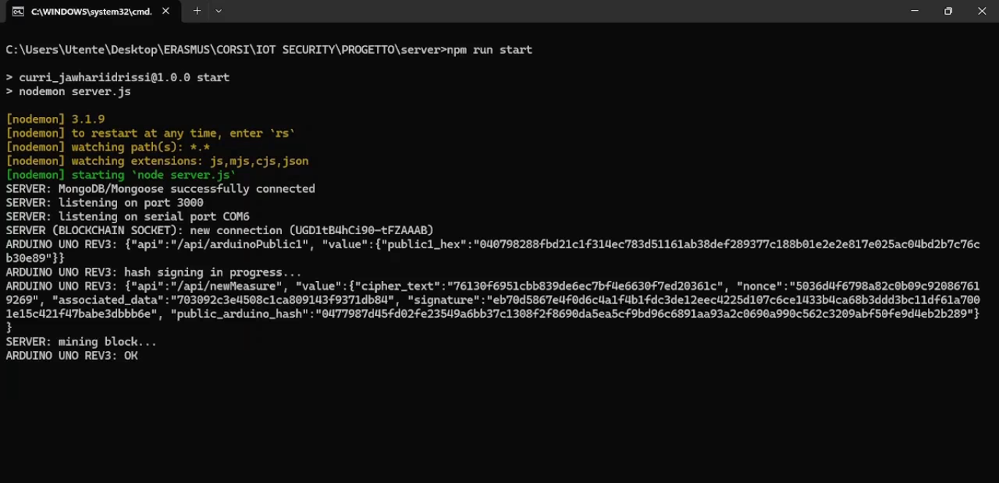
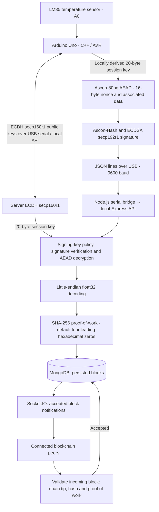

# Arduino & Blockchain

An educational IoT-security prototype that encrypts a temperature reading on an Arduino Uno and records the verified measurement in a Node.js/MongoDB proof-of-work blockchain.

Developed for the *IoT Security* course (Academic Year **2024–2025**) during an Erasmus+ exchange at **[Poznan University of Technology](https://put.poznan.pl/en)** (Poland), as part of the **Computer Engineering** degree program at **[Politecnico di Bari](https://www.poliba.it/en/laurea-magistrale-ingegneria-informatica)** (Italy).

**Scope:** this repository demonstrates an embedded-to-server cryptographic workflow, not a production-grade blockchain, authenticated IoT deployment, or continuous sensor-monitoring platform.

## Preview



*Original demonstration showing the server startup, Arduino communication, cryptographic message exchange, encrypted measurement submission, and blockchain mining.*

For the current startup procedure, see [Getting Started](#getting-started).

## Project Overview

An Arduino Uno Rev3 reads an **LM35 temperature sensor** and sends an encrypted measurement to a Node.js server through the USB serial port. The server verifies an ECDSA signature, decrypts the measurement, mines a block and persists the resulting blockchain with MongoDB/Mongoose. Socket.IO provides a basic peer notification mechanism.

The hardware design considered Ethernet networking, but the demonstrated implementation uses a serial-to-HTTP bridge. The Arduino firmware collects **one measurement during `setup()`** and then remains idle until reset.

## Architecture



**Terminology:** ECDH performs key agreement; ECDSA performs digital signatures. The project uses *legacy Ascon v1.2/Ascon-80pq*, distinct from the standardized Ascon-AEAD128 primitive in NIST SP 800-232.

## Implementation Details

1. The server initializes MongoDB and the blockchain. A new database receives a deterministic genesis block so independent fresh nodes share a starting hash.
2. Arduino creates an ephemeral `secp160r1` ECDH key pair and sends its uncompressed public key to `/api/arduinoPublic1`.
3. The server returns its own ECDH public key; each side derives a 20-byte secret for Ascon-80pq. The server stores one short-lived secret for the attached serial device.
4. The Arduino samples the LM35 sensor, encodes its temperature as an AVR **4-byte little-endian float**, encrypts it and signs the hash of the ciphertext with a `secp192r1` ECDSA key. By default it generates an ephemeral signing key; an optional provisioned header enables a stable signing identity.
5. The server checks the key-enrollment policy and signature, verifies the Ascon authentication tag, decrypts the float32 and consumes the session key to prevent a replay within that session.
6. The server creates a SHA-256-based block, mines the nonce, saves it to MongoDB, and only then broadcasts it. A received block is checked for linking, proof of work, and hash integrity before saving.

The server supports one serial device at a time. For registered-device mode, provision a signing key offline and configure an allowlist. This is software-only enrollment, **not hardware-backed authentication**; see [Security limitations](#security-limitations).

## Technology Stack

- **Embedded:** Arduino Uno Rev3, LM35, Arduino C++, [ASCON suite 0.3.0](https://github.com/rweather/ascon-suite), [micro-ecc 1.0.0](https://github.com/kmackay/micro-ecc).
- **Backend:** Node.js 20 or newer, Express 4, SerialPort 13, Socket.IO 4, Mongoose 8, MongoDB.
- **Cryptography:** Node.js built-in `crypto`, `ascon-js` 1.0.4, `elliptic` 6.6.1 for legacy ECDSA verification, `crypto-js` 4.2.
- **Package management:** npm with a committed `package-lock.json`.

## Blockchain Persistence and Peer Communication

Blocks contain `timestamp`, `data`, `previousHash`, `nonce`, and `hash`. They are stored in MongoDB and reloaded in insertion order. Mined and received blocks are persisted **before** updating the in-memory chain. Serializing block writes prevents two concurrent measurements from extending the same previous hash.

If needed, `PEER_URLS` accepts comma-separated base URLs of other servers; peers use the `/socket/blockchain` namespace and `sendNewBlock`/`receiveNewBlock` events. Servers must share the same genesis and have **matching chain histories** for the next block to be accepted. For non-loopback network interfaces configure a strong `PEER_SHARED_TOKEN`; the Socket.IO transport does not replace TLS or a full peer authentication/consensus protocol.

**Stored-chain compatibility:** the block hash includes the nonce and other stored fields. If a database contains blocks whose hashes fail validation, the server **rejects** the chain rather than rewriting stored records. Back up existing data before connecting the server, and use a **fresh database** for incompatible block histories.

## Repository Structure

```text
arduino/curri_jawhariidrissi/  # Arduino sketch and cryptographic helpers
server/src/  # Backend, blockchain, routes and serial bridge
server/tests/  # Automated Node.js tests and opt-in MongoDB integration test
server/scripts/  # Local device signing-key provisioning
docs/academic-report.pdf  # Academic project report
docs/images/  # Demonstration screenshot
hardware/README.md  # Sensor and serial setup
third_party/  # Bundled Arduino library ZIPs and license notes
```

## Getting Started

**Command location:** Start at the repository root. Step 2 enters `server/` once; keep that working directory for steps 3–5. If running any later step on its own from the repository root, run `cd server` first.

### 1. Prerequisites

- Node.js **20+** and npm.
- A running **MongoDB** database, for example a local service at `mongodb://127.0.0.1:27017`.
- Backend-only tests do not require an Arduino or physical sensor.
- For the complete demonstration: Arduino Uno Rev3, LM35, USB cable, Arduino IDE with the Arduino AVR Boards core, and the bundled ASCON/micro-ecc libraries. See [hardware setup](hardware/README.md) for ZIP installation, board selection and wiring.

### 2. Install the Backend

```bash
cd server
npm ci
cp .env.example .env
```

On Windows PowerShell, use `Copy-Item .env.example .env` instead of `cp`.

Edit the private `server/.env` file. In particular, set `MONGODB_URI` to your own local database, `ARDUINO_COM_PORT` to your USB serial device, and retain `HOST=127.0.0.1` for a local demonstration. **Do not commit `.env` or reuse credentials from another environment.** Before staging files with Git, list `server/.env`, `arduino/curri_jawhariidrissi/device_identity.h`, and `server/node_modules/` in your local `.git/info/exclude`, or exclude these paths from commits manually. Local Git exclusions are not part of this repository.

### 3. Configure Signing-Key Enrollment (Optional, Recommended)

Without an optional private device-identity header, the firmware creates an ephemeral ECDSA key at every reset. The server instead **rejects unknown signing keys by default** (`ALLOW_UNREGISTERED_SIGNERS=false`). To provision a stable identity on a development machine, from `server/` run:

```bash
npm run provision:device
```

This command uses the host's cryptographic RNG and writes a private P-192 signing key to `arduino/curri_jawhariidrissi/device_identity.h`. **This header contains a private signing key: never commit or share it, and never publicly distribute firmware images containing that key.** The command only prints the corresponding *public* key. It refuses to overwrite an existing identity. Add that public key to `AUTHORIZED_SIGNING_KEYS` in the private `server/.env`, keeping `ALLOW_UNREGISTERED_SIGNERS=false`. Multiple allowed devices may be separated by commas (the server still manages one serial session at a time). Compile the sketch from the same Arduino directory: with the private header present, it uses the provisioned key, while the serial JSON protocol stays unchanged.

For a classroom demonstration without a provisioned signing identity, explicitly set:

```dotenv
ALLOW_UNREGISTERED_SIGNERS=true
```

This fallback **does not authenticate the device**. A provisioned key improves the server's authorization policy but **does not give an Arduino Uno secure key storage or certified ECDSA nonce entropy**. Its flash contents may be extracted and its RNG is based on unverified analog timings. Consequently neither mode is appropriate for real-world security-critical deployment.

### 4. Run

```bash
npm start
```

Optionally check the local backend's status at `http://127.0.0.1:3000/health`. With `ARDUINO_COM_PORT` empty, the HTTP backend starts without an attached Arduino. With a configured serial port, reset the board after the server starts. The expected server reply on successful measurement is `OK`.

The bridge only forwards the known `arduinoPublic1` and `newMeasure` APIs. It ignores non-JSON debug messages from Arduino. Error replies are terminated with a newline, as required by the Arduino line reader.

## Tests

From `server/`, run:

```bash
npm test
```

The tests exercise genesis and proof-of-work validity, database persistence failures through a mock model, concurrent block production, remote block validation, malformed ECDH input, ECDH shared-key agreement, Ascon-80pq encryption/decryption, ECDSA verification, enrolled-key acceptance, malformed signatures, authentication-tag tampering, replay rejection, parallel submission locking, and a simulated serial port. A provisioning test validates generated key and public-key pairing. For the **opt-in real-database integration test**, first start MongoDB locally and run `MONGO_TEST_URI=mongodb://127.0.0.1:27017/iot_security_test npm test` (PowerShell: `$env:MONGO_TEST_URI="mongodb://127.0.0.1:27017/iot_security_test"; npm test`). The test uses and drops only a randomly named collection; ensure the URI targets a disposable test database. `MONGO_TEST_URI` is documented in `.env.example` for completeness, but the test runner reads it from the shell environment rather than automatically loading the `.env` file.

## Security Limitations

The backend validates input, uses local-only binding by default, validates incoming blocks, restricts peer connections, and consumes a shared-key session after a measurement. These measures are suitable for a teaching prototype, **not a security certification**.

- **Device identity:** The ECDH exchange is unauthenticated, and the fallback firmware creates a new ECDSA key on each reset. `ALLOW_UNREGISTERED_SIGNERS=true` does not authenticate the device. An optional locally generated persistent signing key plus a server-side enrolled-key allowlist blocks unknown signers, **but the Uno cannot protect its embedded private key against physical extraction**. Neither configuration constitutes hardware-backed authentication.
- **Entropy:** a floating analog pin and timing measurements do not constitute a verified cryptographic random-number generator. The Arduino entropy source is bounded to avoid infinite loops, but the effective entropy is unproven. A hardware-approved RNG is necessary for security-sensitive deployments.
- **Cryptography and dependency versions:** Ascon-80pq is used for compatibility with the Arduino firmware. The package `elliptic@6.6.1` has a [published advisory](https://github.com/advisories/GHSA-848j-6mx2-7j84) affecting signature generation, with no patched upstream release as of November 2026; the backend uses it for **verification only** (the automated test fixture does sign ephemeral test messages). Replacing the signature-verification library would require cryptographic interoperability validation. Do not treat the package as generally free of security concerns.
- **Network and blockchain:** the blockchain is a simple educational chain, not an adversarial consensus mechanism. Socket.IO peer messages and local API calls are not a replacement for transport security, authorization or Sybil resistance. Setting `ALLOW_REMOTE_API=true` expands the attack surface.
- **Protocol:** sessions are single-device and expire after five minutes; replay protection is scoped to a session, not globally to all device identities or deployments.

## Documentation

The [academic report (English, PDF)](docs/academic-report.pdf) presents the university project, its protocol and hardware design. Use the setup instructions and security guidance in this README when working with the repository.

## Contributors

- [Cosimo Curri](https://github.com/cosimo-curri)
- [Selma Jawhari Idrissi](https://github.com/selmaidrissi16-01)

## License and Third-Party Materials

The original project code is licensed under the [MIT License](LICENSE). Third-party materials remain subject to their respective licenses and terms.

The archived Arduino libraries remain subject to their **own** license notices retained inside each archive; see [third-party attributions](third_party/README.md). The [academic report](docs/academic-report.pdf) remains an academic document with its original attribution.
